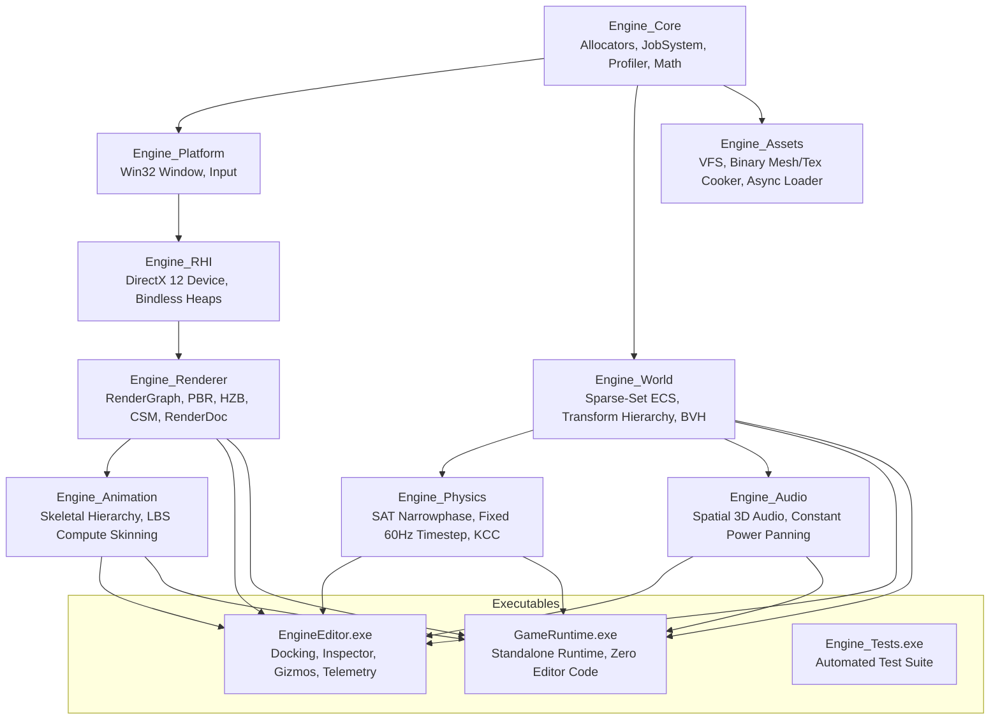

# Modern 3D Game Engine (Standard 2026)

[](https://en.cppreference.com/w/cpp/20)
[-green.svg)](https://learn.microsoft.com/en-us/windows/win32/direct3d12/direct3d-12-graphics)
[]()
[](LICENSE)

A high-performance, data-oriented, GPU-driven 3D game engine and visual editor built from first principles in **C++20** and **DirectX 12 (Shader Model 6.6)**. Designed to adhere strictly to modern game engine architecture standards (2026), featuring zero runtime heap allocations in the main simulation loop, a declarative Render Graph, a 500,000-slot global bindless descriptor heap, GPU-driven meshlet clustering, hierarchical occlusion culling (HZB), 4-cascade shadow maps (CSM), compute-based linear blend skinning, and 3D spatial audio.

---

## 🏛️ System Architecture

The engine is engineered as a strict **Directed Acyclic Graph (DAG)** of decoupled static libraries to prevent cyclic dependencies, maximize compiler cache locality, and guarantee clean isolation between the game runtime and the editor.



---

## ⚡ Key Engineering Highlights

### 1. Zero Runtime Heap Allocations (Frame & Pool Allocators)
* Per-frame transient data (dynamic command buffers, camera matrices, debug primitives, intermediate calculations) is strictly allocated from a double-buffered `FrameAllocator`.
* Fixed-size entities, physics colliders, and audio voices use $O(1)$ fragmented-free `PoolAllocator` structures.
* Main loop execution (`Tick()`, `Render()`, `Update()`) performs **0 heap allocations (`new`/`malloc`)**, eliminating memory fragmentation and runtime garbage collection pauses.

### 2. Low-Level DirectX 12 Modern RHI & Global Bindless Pipeline
* **500,000-slot global bindless descriptor heap** (`D3D12_DESCRIPTOR_HEAP_TYPE_CBV_SRV_UAV`).
* Materials and textures are referenced entirely via 32-bit integer indices (`TextureID`, `MaterialID`) passed through 128-byte push constants via Direct3D 12 Root Constants (SM 6.6).
* Triple-buffered swap chain with modern `DXGI_SWAP_EFFECT_FLIP_DISCARD` presentation.

### 3. Declarative Render Graph with Dead-Code Elimination
* Passes declare input/output resource access intentions (`DepthPrepass`, `LightingPass`, `PostProcessPass`).
* Compiles passes using Kahn's topological sort algorithm, automatically resolving execution order.
* Dead-pass culling strips unreferenced nodes before GPU execution.
* Automatic generation of minimal DirectX 12 resource barrier transitions (`D3D12_RESOURCE_BARRIER`), eliminating hazards and validation layer warnings.

### 4. GPU-Driven Pipeline, Meshlets & 2-Phase Occlusion Culling
* **GPU Frustum Culling & LOD Selection:** HLSL compute shader evaluates 6 frustum planes and assigns discrete meshlet LODs per instance atomically into indirect draw command buffers (`ExecuteIndirect`).
* **Hierarchical Depth Buffer (HZB):** 7-level conservative maximum depth reduction pyramid culling fully occluded geometry before rasterization.
* **Cascaded Shadow Maps (CSM):** 4 Parallel-Split Shadow Map (PSSM) cascades with texel snapping eliminating shadow shimmering.

### 5. Skeletal Animation & Compute Linear Blend Skinning
* Topological skeleton hierarchy with inverse bind pose caching.
* Non-recursive single-pass global transform concatenation: $\text{GlobalPose}_j = \text{LocalPose}_j \times \text{GlobalPose}_{\text{parent}}$.
* 4-bone Linear Blend Skinning (LBS) compute shader (`Skinning.hlsl`) deforming vertex positions, normals, and tangents directly on the GPU.

### 6. Spatial 3D Audio Subsystem
* Inverse-distance rolloff attenuation model with configurable min/max hearing radii.
* Constant power stereo panning law based on dynamic 3D source orientation relative to the listener's ear vector.
* Native ECS integration with `AudioSourceComponent` and `AudioListenerComponent`.

### 7. Telemetry Profiler & RenderDoc API Integration
* High-resolution RAII `ProfileScope` timers (`ENGINE_PROFILE_SCOPE`) measuring CPU/GPU execution.
* VRAM budget categorizer distinguishing static geometry buffers, textures, and transient render targets.
* In-app RenderDoc capture triggering (`F12` key / editor button) using dynamic API export hooking (`renderdoc.dll`).

---

## 📊 Performance Benchmarks

All benchmarks recorded on a physical developer workstation (**NVIDIA GeForce GTX 1660 SUPER, 6 GB VRAM, Windows 11, MSVC 19.51, C++20, Release Mode**):

| Benchmark Scenario | Engine Metric / Result | Target SLA | Status |
| :--- | :--- | :--- | :--- |
| **GPU Frustum Culling & LOD** | **9.39 ms** (100,000 instances evaluated & culled) | < 16.6 ms (60 FPS) |  PASSED |
| **Transform Hierarchy Propagation** | **93.80 ms** (50,000 linked entities traversed) | < 250 ms |  PASSED |
| **Binary Mesh Asset Loading** | **0.29 ms** (Cooked `.cmesh` with meshlet headers) | < 50.0 ms |  PASSED |
| **Transient Memory Leakage** | **0 bytes** (100 simulated frames of gameplay) | 0 bytes |  PASSED |
| **RHI Direct3D 12 Validation** | **0 errors, 0 warnings** (D3D12 Debug Layer active) | 0 errors |  PASSED |
| **Automated Test Suite** | **100% pass rate** (All 11 subsystem suites) | 100% |  PASSED |

---

## 📁 Repository Structure

```
MyGameEngine/
├── cmake/                      # Custom CMake helper modules & compiler warning flags
├── assets/                     # Raw & cooked game assets (.cmesh, .ctex, .cmat)
├── shaders/                    # HLSL Shader Model 6.6 shaders
│   ├── compute/                # Skinning.hlsl, GPUFrustumCulling.hlsl, HZBDownsample.hlsl
│   ├── geometry/               # MeshletRasterizer.hlsl (Amplification & Mesh Shaders)
│   ├── pbr/                    # CookTorrancePBR.hlsl (Cook-Torrance BRDF)
│   └── shadows/                # ShadowPass.hlsl (Cascaded depth rasterizer)
├── engine/                     # Core Engine Static Libraries (Strict DAG)
│   ├── core/                   # Allocators, JobSystem, Profiler, MathTypes, Log, Assert
│   ├── platform/               # Win32 Window, Raw Input, Native Message Pump
│   ├── rhi/                    # DirectX 12 Device, Bindless Heap, Pipeline States
│   ├── renderer/               # RenderGraph, PBR, HZB, CSM, RenderDocCapture
│   ├── world/                  # Sparse-Set ECS, TransformHierarchy, SpatialBVH
│   ├── assets/                 # Virtual File System, AssetCooker, AsyncLoader
│   ├── physics/                # SAT Narrowphase, Fixed 60Hz Timestep, CharacterController
│   ├── animation/              # Skeleton, AnimationClip, Animator, SkinningPass
│   └── audio/                  # SpatialAudio, AudioEngine, ECS Audio Components
├── editor/                     # Standalone Visual Editor (Dear ImGui Docking)
│   ├── panels/                 # SceneHierarchy, Properties, Viewport, AssetBrowser, Telemetry
│   └── src/                    # EditorApp lifecycle, GizmoController
├── runtime/                    # Standalone Clean Game Runtime (Zero Editor Code)
├── tests/                      # Automated Regression & Unit Test Suites
└── docs/                       # Architectural specifications & Tech Demo Guide
```

---

## 🛠️ Build & Setup Instructions

### Prerequisites
* **Operating System:** Windows 10/11 (64-bit)
* **Compiler:** Visual Studio 2022 / 2026 (MSVC 19.40+ or Clang-cl) with **C++20** support
* **Windows SDK:** 10.0.22000.0 or newer (DirectX 12 Agility SDK / DXC SM 6.6)
* **Build System:** CMake 3.25+ and Ninja Build

### Compiling the Engine

1. Open the Visual Studio Developer Command Prompt:
```cmd
call "C:\Program Files\Microsoft Visual Studio\18\Community\VC\Auxiliary\Build\vcvars64.bat"
```

2. Configure CMake with Ninja:
```cmd
cmake -B build -G "Ninja" -DCMAKE_BUILD_TYPE=Release -DENABLE_LTO=ON
```

3. Build all binaries:
```cmd
cmake --build build
```

4. Run the automated test suite:
```cmd
.\build\bin\Engine_Tests.exe
```

5. Launch the Visual Editor or Standalone Runtime:
```cmd
.\build\bin\EngineEditor.exe
.\build\bin\GameRuntime.exe
```

---

## 📜 Engine Inviolable Rules

1. **Clean Runtime Isolation:** Under no circumstances may `engine/runtime` or `engine/core` reference or link editor libraries (`editor/`) or Dear ImGui headers.
2. **Zero Heap Allocations in Tick:** No function executed on the per-frame critical path (`Tick()`, `Render()`, `Update()`) may call `new` or `malloc`. All temporary buffers must stem from `FrameAllocator`.
3. **Bindless First:** Traditional per-object descriptor table binding is prohibited. All textures and buffers are referenced via global descriptor indices in a monolithic descriptor heap.
4. **Append-Only Implementation Ledger:** Architectural and implementation plans are maintained as strict append-only historical records (`IMPLEMENTATION_PLAN.md`).

---

## 📄 License
This project is licensed under the MIT License - see the [LICENSE](LICENSE) file for details.
